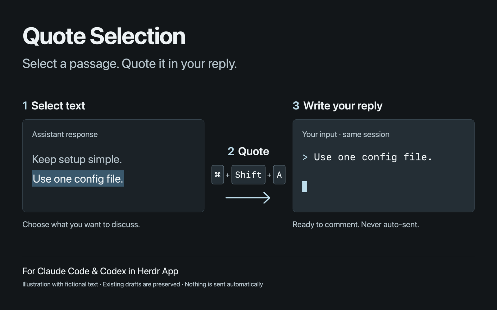

# Quote Selection

[English](README.md) | 日本語

Herdr App の Claude Code／Codex で、選択した文章を入力欄へ引用する Mod です。

1. ターミナルの文章を選択してください。アプリがマウスを使う場合は Shift を押しながら選択してください。
2. 同じターミナルにフォーカスしたまま **Cmd＋Shift＋A** を押してください。
3. 既存入力の末尾に `> ` 付きの引用が入り、その下の空行から返信を書けます。自動送信はしません。

レイアウトの変更は不要です。成功時はダイアログ・暗転・通知を出さず、失敗時だけ通知します。



プレビューは操作を説明するためのサンプルで、実セッションのスクリーンショットではありません。

## 必要なもの

- macOS、Herdr App、herdr-core の `hc`、Python 3。
- macOS 標準の `/usr/bin/env` と `/usr/bin/pbpaste`。
- `python3` と `hc` が Herdr App の実行環境の PATH にあること。
- Claude Code／Codex の通常の入力画面。Vim モードや変更したキー割当は対象外です。

確認した版は [VERIFICATION.md](VERIFICATION.md) に記載しています。Node.js はテスト用で、利用時には不要です。

## 導入

まずインストール先の `~/.config/herdr-app/AGENTS.md` と、このリポジトリの全ファイルを確認してください。Mods はコマンドを実行できる信頼されたコードとして動作します。

1. `mods/quote-selection/` の `main.js`、`mod.json`、`quote.py` を `~/.config/herdr-app/mods/quote-selection/` にコピーしてください。同名の Mod があれば先に比較し、上書きしないでください。
2. `keys.json` は**設定全体ではなく追加用スニペット**です。既存の `~/.config/herdr-app/keys.json` に、次の1項目だけを手動でマージしてください。

```json
{
  "global": {
    "cmd-shift-a": "mod.open:quote-selection"
  }
}
```

`global`・`terminal`・`layout:<name>` などの既存割当を確認し、Cmd＋Shift＋A が使われていたら別のキーを選んでください。既存のキー設定ファイルを丸ごと置き換えないでください。レイアウトや `terminal_menu` の変更は不要です。

3. `herdr-app check ~/.config/herdr-app/mods/quote-selection` を実行してください。
4. テスト用セッションで、既存入力が残ること、引用の下に返信行ができること、送信されないことを確認してください。

無効にするには、追加したキー割当を削除してください。既存の Mod やレイアウトは変更しないでください。

## 実行する処理とアクセス範囲

| 処理 | 用途 |
| --- | --- |
| `env LC_ALL=en_US.UTF-8 /usr/bin/pbpaste` | 現在のシステムクリップボードから選択文を UTF-8 で読みます。 |
| `python3 <App home>/mods/quote-selection/quote.py -- <terminal> <text>` | 対象ターミナルと選択文をローカルのヘルパーへ渡します。 |
| `hc get` / `hc read` | 起動時にフォーカスしていた端末の状態・画面を読みます。 |
| `hc attach` | 一時接続し、入力末尾への移動と、行ごとの貼付け・Ctrl+J による改行を行います。 |

端末の ID はショートカット起動時に固定します。ヘルパーは Claude Code／Codex の状態と入力欄を確認します。空選択や制御文字を拒否し、入力欄が分からなければ引用を追加しません。Enter／`hc send` は使用しません。

Mod 自身は外部 AI API や HTTP を呼ばず、選択文・画面のログや履歴ファイルを保存しません。`hc` の既存サービスに接続します。接続先は `hc` の設定にも依存するため、ネットワーク隔離を保証するものではありません。選択文はプロセス引数を通るため、OS のプロセス情報を読める環境では見える可能性があります。内容を第三者へ送る処理は追加していませんが、利用者が後から送信した内容は利用中のエージェントの通常の送信先へ渡ります。

## 制約

- 選択解除時の自動コピーを利用します。選択後に別の文章をコピーした場合や選択せずに押した場合は、現在のクリップボード内容を使います。選択元との同一性は検証できません。
- ローカルの macOS 端末向けです。リモート端末は対応範囲に含めません。
- 既存入力がある場合、引用前に改行を1つ追加します。コメントとの間に空行を置きたい場合は、次の引用の前に手動で改行を1つ入れてください。
- スクロール位置の保存・復元は行いません。fullscreen アプリ内部と端末の通常履歴ではスクロールの仕組みが異なり、読んでいた位置の保持は保証しません。
- 許可確認などのダイアログを閉じてから実行してください。処理中は同じ入力欄を同時に編集しないでください。
- 通常の入力画面の表示形式に依存します。Vim モード、カスタムキー、変更したフッター、画面から隠れるほど長い入力には対応していません。
- 応答生成中も状態としては受け付けますが、その間の実機動作は別途確認が必要です。試す際は入力待ちの状態で実行してください。

## 開発と確認

```sh
herdr-app check mods/quote-selection
```

`mods/quote-selection` に移動して次を実行してください。

```sh
python3 -m unittest quote_test.py
node --test annotation.test.mjs
```

API や表示形式が変わった場合の再構築用ブリーフは [RECIPE.md](RECIPE.md) に記載しています。公式の配布条件は [Herdr Mods](https://herdr.dev/mods/)、構成例は [Tmux prefix](https://herdr.dev/mods/herdrdev/tmux-prefix/) を参照してください。
