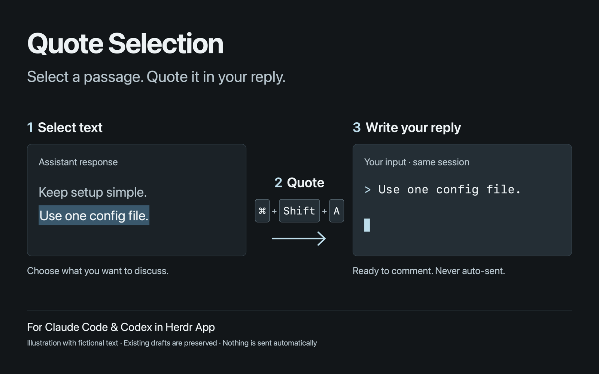

# Quote Selection

English | [日本語](README.ja.md)

Quote selected terminal text into Claude Code and Codex drafts in [Herdr App](https://herdr.dev).

1. Select text in the terminal. Hold Shift while selecting if the application captures mouse events.
2. Keep that terminal focused and press **Cmd+Shift+A**.
3. The quote is appended to your existing draft with `> ` before each line. Continue your reply on the blank line below it. Nothing is submitted automatically.

No layout changes are needed. Successful insertion shows no dialog, dimming, or notification. Only failures produce a notification.



This preview illustrates the interaction. It is not a screenshot of a real session.

## Requirements

- macOS, Herdr App, herdr-core's `hc`, and Python 3.
- The macOS utilities `/usr/bin/env` and `/usr/bin/pbpaste`.
- `python3` and `hc` available on the PATH used by Herdr App.
- The standard Claude Code or Codex input screen. Vim mode and custom editing bindings are outside the supported scope.

Tested versions and validation limits are documented in [VERIFICATION.md](VERIFICATION.md). Node.js is needed only for development tests.

## Install

Read your installed `~/.config/herdr-app/AGENTS.md` and every file in this repository first. Herdr Mods are trusted code that can run commands.

1. Copy `main.js`, `mod.json`, and `quote.py` from `mods/quote-selection/` into `~/.config/herdr-app/mods/quote-selection/`. If a Mod already exists at that path, compare it first rather than overwriting it.
2. Merge the following single binding into your existing `~/.config/herdr-app/keys.json`. The included `keys.json` is an **additive snippet, not a replacement configuration**.

```json
{
  "global": {
    "cmd-shift-a": "mod.open:quote-selection"
  }
}
```

Check existing bindings in `global`, `terminal`, and any `layout:<name>` sections. If Cmd+Shift+A is already assigned, choose another key. Preserve all unrelated settings. No layout or `terminal_menu` changes are required.

3. Run `herdr-app check ~/.config/herdr-app/mods/quote-selection`.
4. Try a disposable session and confirm that your draft is preserved, the cursor ends below the quote, and nothing is submitted.

To disable the Mod, remove the binding you added. Leave unrelated Mods and layouts unchanged.

## Commands and data access

| Command | Purpose |
| --- | --- |
| `env LC_ALL=en_US.UTF-8 /usr/bin/pbpaste` | Read the current system clipboard as UTF-8 |
| `python3 <App home>/mods/quote-selection/quote.py -- <terminal> <text>` | Pass the target terminal and text as separate arguments to the local helper |
| `hc get` / `hc read` | Inspect the state and screen of the terminal captured when the shortcut was invoked |
| `hc attach` | Temporarily attach, move to the draft's end, and insert bracketed-paste lines separated by Ctrl+J |

The target terminal is captured once at invocation. The helper checks the agent state and input screen, rejects empty text and control characters, and does not paste if it cannot identify the composer. It does not use Enter or `hc send`.

The Mod itself makes no HTTP or external AI API calls and does not save selection or screen logs. It connects through the existing `hc` service; the destination also depends on your `hc` configuration, so this is not a network-isolation guarantee. Selected text travels in process arguments and may be visible to software that can inspect local processes. The Mod adds no third-party transmission step. Text you later submit follows your agent's normal sending behavior.

## Limitations

- Selection release copies text to the clipboard. Copying something else before invoking the shortcut changes what is quoted. Invoking without a fresh selection uses the existing clipboard text; the Mod cannot verify its source.
- Supported scope is local macOS terminals. Remote terminals are outside that scope.
- When a draft exists, one newline is inserted before the next quote. To leave a blank line between an existing comment and a new quote, add one newline yourself before invoking the shortcut.
- Scroll positions are not saved or restored. Fullscreen application scrolling and native terminal scrollback behave differently; preservation of your reading position is not guaranteed.
- Close permission dialogs before invoking the Mod. Do not edit the same draft while insertion is running.
- The parser depends on the standard prompt and footer presentation. Vim mode, custom keys or footers, and drafts larger than the visible composer are unsupported.
- Working-state input is accepted by the state check, but live streaming behavior has not been independently verified. Start with an idle agent when trying the Mod.

## Development

```sh
herdr-app check mods/quote-selection
```

From `mods/quote-selection/`, run:

```sh
python3 -m unittest quote_test.py
node --test annotation.test.mjs
```

[RECIPE.md](RECIPE.md) describes how to rebuild the Mod if APIs or terminal rendering change. See [Herdr Mods](https://herdr.dev/mods/) for the official package format and [Tmux prefix](https://herdr.dev/mods/herdrdev/tmux-prefix/) for an example.

## License

[MIT License](LICENSE)
